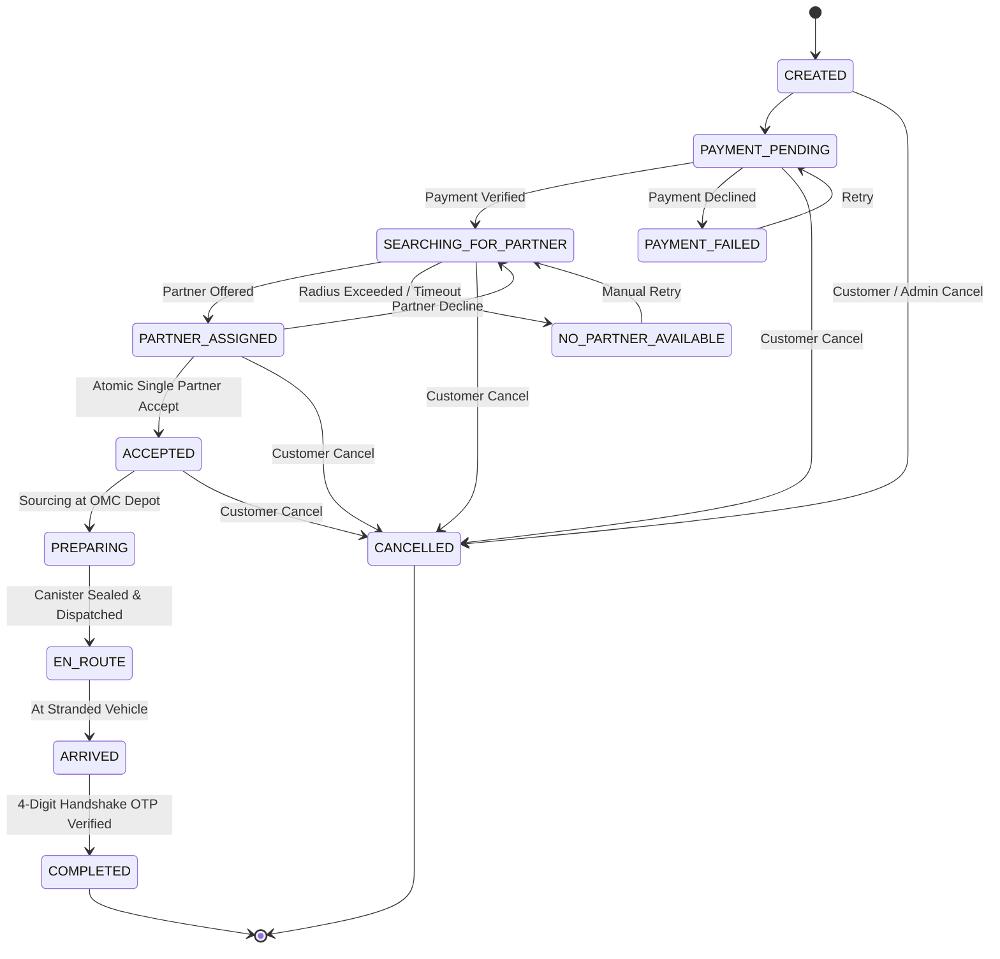

# Fuel Rescue — System Architecture & Design Specification

## 1. System Overview

Fuel Rescue is engineered as a modular monolith Next.js application utilizing the App Router, designed for rapid response emergency fuel logistics.

```
                      ┌──────────────────────────────────────┐
                      │          Customer / Rescuer /        │
                      │          Admin Next.js Frontend      │
                      └──────────────────┬───────────────────┘
                                         │
             ┌───────────────────────────┴───────────────────────────┐
             ▼                                                       ▼
┌─────────────────────────┐                             ┌─────────────────────────┐
│     Business Engines    │                             │    Data Access Layer    │
│  - Pricing Engine       │                             │  - Supabase PostgreSQL │
│    (₹30 / 4km Rule)     │                             │  - Row Level Security   │
│  - State Machine        │                             │  - MockStore Pub/Sub    │
│  - Atomic Dispatch      │                             │    (Zero-Setup Hybrid)  │
│  - OSRM Road Router     │                             └─────────────────────────┘
└─────────────────────────┘
```

## 2. Order Lifecycle State Machine



## 3. Concurrency-Safe Atomic Partner Assignment
 
To prevent race conditions where two or more responders simultaneously attempt to accept the same emergency broadcast:
 
1. **Database-Enforced Atomic Operation (`supabase/migrations/20261029000001_fuel_rescue_schema.sql`)**:
   - Uses a PostgreSQL transaction function `accept_order_atomic(p_order_id UUID, p_partner_id UUID)` executing a row-level conditional lock:
     ```sql
     SELECT id, status, partner_id 
     INTO v_order
     FROM public.orders 
     WHERE id = p_order_id 
     FOR UPDATE;

     IF v_order.status NOT IN ('SEARCHING_FOR_PARTNER', 'PARTNER_ASSIGNED') THEN
       RAISE EXCEPTION 'Order is no longer available (current status: %)', v_order.status;
     END IF;

     UPDATE public.orders
     SET status = 'ACCEPTED', partner_id = p_partner_id, updated_at = NOW()
     WHERE id = p_order_id;
     ```
   - Enforces unique active partner constraint via partial unique index:
     ```sql
     CREATE UNIQUE INDEX idx_single_active_partner_per_order
     ON public.partner_assignments (order_id)
     WHERE status = 'ACTIVE';
     ```

2. **Server-Side API Route (`/api/orders/[id]/accept`)**:
   - Handles acceptance requests through a single atomic mutation endpoint, preventing client-side optimistic races.
   - In demo mode, executes atomic Compare-And-Swap (CAS) in `mockStore.atomicAcceptOrder(orderId, partnerId)`.

3. **Automated Verification**:
   - `tests/dispatch.test.js` runs `Promise.all` simultaneous acceptance calls from two distinct partners.
   - Asserts that exactly one succeeds (`200 OK`) and the other fails with a `409 Conflict` error.

---

## 4. Server-Authoritative Pricing Algorithm

All order prices are calculated and finalized on the server (`/api/orders` and `/api/pricing/quote`). Client-provided prices are discarded.

```
                  ┌───────────────────────┐
                  │ Road Distance (dist)  │
                  └──────────┬────────────┘
                             │
              Is dist <= 4.0 km?
             /                 \
          YES                   NO
          /                       \
   Fee = ₹30.00         Fee = ₹30.00 + (dist - 4.0) × ₹14.00
          \                       /
           └──────────┬──────────┘
                      │
   Total = Fuel_Subtotal + Fee + Safety_Canister_Fee (₹15)
```

- **0.0 km**: ₹30.00 base delivery fee
- **4.0 km (inclusive boundary)**: ₹30.00 base delivery fee
- **5.0 km**: ₹44.00 (`₹30.00 + 1.0 km × ₹14.00/km`)

---

## 5. Mapping, GPS & Navigation Architecture

- **Map Tiles**: Leaflet with CartoDB Positron & OpenStreetMap.
  - **API Key Required**: **NONE**. Leaflet and OpenStreetMap tiles operate without API keys or external billing accounts.
- **Reverse Geocoding**: `/api/geocode` proxying to OpenStreetMap Nominatim. Tapping "Use Current GPS" or dragging the map marker triggers reverse geocoding to update the street address automatically.
- **Navigation Handoff**: The partner console generates a direct navigation URL:
  `https://www.google.com/maps/dir/?api=1&destination=${lat},${lng}`
  passing the customer's exact 6-decimal-place coordinates to Google Maps / Apple Maps on the partner's device.

---

## 6. Security, Authentication & Isolation

- **Role Verification**: Verified server-side via session tokens or authenticated profile queries.
- **Client Price Isolation**: The server strictly calculates prices based on quantity and verified road coordinates; any client-provided price tampering is discarded.
- **State Transition Guard**: `validateTransition` strictly forbids illegal or out-of-order state transitions (e.g., jumping from `PARTNER_ASSIGNED` directly to `COMPLETED`).
- **Location Privacy**: Partner continuous coordinates are masked and transmitted only while an active assigned order is in `EN_ROUTE` or `ARRIVED` status.
