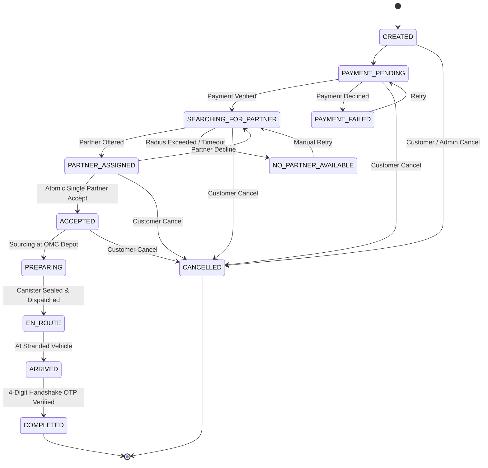

# Fuel Rescue — System Architecture & Design Specification

## 1. System Overview

Fuel Rescue is engineered as a modular monolith Next.js application utilizing the App Router, designed for rapid response emergency fuel logistics.

```
                      ┌──────────────────────────────────────┐
                      │          Customer / Rescuer /        │
                      │          Admin Next.js Frontend      │
                      └──────────────────┬───────────────────┘
                                         │
             ┌───────────────────────────┴───────────────────────────┐
             ▼                                                       ▼
┌─────────────────────────┐                             ┌─────────────────────────┐
│     Business Engines    │                             │    Data Access Layer    │
│  - Pricing Engine       │                             │  - Supabase PostgreSQL │
│    (₹30 / 4km Rule)     │                             │  - Row Level Security   │
│  - State Machine        │                             │  - MockStore Pub/Sub    │
│  - Atomic Dispatch      │                             │    (Zero-Setup Hybrid)  │
│  - OSRM Road Router     │                             └─────────────────────────┘
└─────────────────────────┘
```

## 2. Order Lifecycle State Machine



## 3. Concurrency-Safe Partner Assignment

To prevent race conditions where two responders simultaneously accept the same emergency dispatch:
1. **Database Level**: Unique partial index in PostgreSQL:
   ```sql
   CREATE UNIQUE INDEX idx_single_active_partner_per_order
   ON public.partner_assignments (order_id)
   WHERE status = 'ACTIVE';
   ```
2. **Application Level**: `validatePartnerAcceptance` strictly validates that the order state has not already moved to `ACCEPTED`, `PREPARING`, or `EN_ROUTE`.

## 4. Server-Authoritative Pricing Algorithm

```
                  ┌───────────────────────┐
                  │ Road Distance (dist)  │
                  └──────────┬────────────┘
                             │
              Is dist <= 4.0 km?
             /                 \
          YES                   NO
          /                       \
   Fee = ₹30.00         Fee = ₹30.00 + (dist - 4.0) × ₹14.00
          \                       /
           └──────────┬──────────┘
                      │
   Total = Fuel_Subtotal + Fee + Safety_Canister_Fee (₹15)
```

## 5. Security & Isolation

- **Role Verification**: Verified server-side via session tokens or authenticated profile queries.
- **Client Price Isolation**: The server strictly calculates prices based on quantity and verified road coordinates; any client-provided price tampering is discarded.
- **Location Privacy**: Partner continuous coordinates are masked and transmitted only while an active assigned order is in `EN_ROUTE` or `ARRIVED` status.
